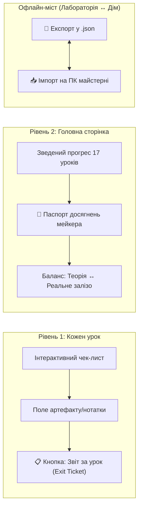

# ПАСПОРТ ТА СИСТЕМНА ІНСТРУКЦІЯ ПРОЄКТУ
# «Адаптивна цифрова майстерня: Arduino + 3D CAD + 3D Друк + AI + Maker»

> **Призначення документа:** цей файл є повним технічним, педагогічним та операційним описом платформи. Він створений так, щоб будь-який розробник або новий ШІ-агент у новому чаті міг миттєво зрозуміти структуру, філософію, стек, контракти даних і без додаткових запитань продовжити розробку будь-якого модуля чи уроку.

---

## 1. ПАСПОРТ ПРОЄКТУ (EXECUTIVE SUMMARY)

| Параметр | Значення |
| :--- | :--- |
| **Повна назва проєкту** | «Адаптивна цифрова майстерня: Arduino + 3D CAD + 3D Друк + AI + Maker» |
| **Освітня установа** | Київський професійний коледж «ТЕХНО-АРТ» імені Бадрі Лолашвілі (КПКТА) |
| **Освітній простір** | Лабораторія мейкерства та гурток «Робототехніка» |
| **Обсяг програми** | 250 академічних годин (модульна адаптивна траєкторія) |
| **Цільова аудиторія** | Студенти коледжу та гуртківці віком 15–19 років |
| **Формат навчання** | Змішане (Blended Learning): самостійне вивчення у вільний час + очна практика на залізі в майстерні |
| **Живий сайт** | [https://kpkta-robotics.github.io/maker-lab/](https://kpkta-robotics.github.io/maker-lab/) |
| **Робочий Git-репозиторій** | `d:\Learn Arduino\maker-lab\` |
| **Дзеркальна папка розробки** | `d:\Learn Arduino\arduino-course\` |
| **Архітектурний стек** | Pure Web Standards (HTML5, CSS3, ES6 Vanilla JS), Zero-Backend, Offline-First, GitHub Pages |
| **Головний валідатор QA** | `python sync_course.py` |

---

## 2. МАТРИЦЯ НАВИЧОК ТА ПЕДАГОГІЧНА ЛОГІКА

Головна мета курсу — не заучування синтаксису, а **наскрізне створення працюючого фізичного виробу під ключ**:
$$\text{Проблема} \longrightarrow \text{Схема Wokwi} \longrightarrow \text{Код Arduino} \longrightarrow \text{Обмір штангенциркулем} \longrightarrow \text{3D CAD} \longrightarrow \text{Друк Snapmaker A350} \longrightarrow \text{Готовий Maker-гаджет}$$

### 2.1. Шість базових інженерних компетентностей

1. **Електроніка та схемотехніка:** розуміння закону Ома ($I = U / R$), живлення 5V/3.3V/GND, захист від КЗ (самовідновлювані запобіжники Polyfuse), струмообмежувальні резистори, підтяжки `INPUT_PULLUP`, захист від брязкання контактів (Debounce).
2. **Програмування мікроконтролерів (C++):** цикли `setup()` / `loop()`, дискретні та аналогові сигнали (`digitalRead`, `digitalWrite`, `analogRead`, `analogWrite` / ШІМ), масиви пінів, функції таймінгу (`delay`, `millis`), робота з Serial-телеметрією.
3. **Точні вимірювання та інженерний 3D CAD:** обмір друкованих плат, сенсорів і сервоприводів штангенциркулем з точністю 0.1 мм, проєктування корпусів і рухомих петель у Tinkercad та Autodesk Fusion 360, врахування зазорів під кріплення гвинтами М3.
4. **Адитивне виробництво (3D-друк на Snapmaker A350):** нарізка шарів у Snapmaker Luban / PrusaSlicer, калібрування висоти столу (Bed Mesh) та Z-Offset, фізика адгезії першого шару, температурні режими PLA/PETG/TPU, боротьба з анізотропією міцності.
5. **Інженерний дебаг та Troubleshooting:** системний алгоритм діагностики неполадок, виявлення непропаїв, перевантажень по струму, дефектів друку (Stringing, Warping, Layer Shift), читання помилок компілятора.
6. **Інженерна культура, безпека та ШІ-колаборація:** робота в захисній камері Enclosure, поведінка біля гарячого сопла 205°C та рухомих лінійних приводів ЧПК; формулювання промптів до ШІ за інженерним принципом: *«Симптом + Гіпотеза + Контекст»* замість прохання «напиши за мене».

### 2.2. 4-кроковий дослідницький цикл кожного уроку

Кожне заняття будується за незмінною формулою, що запобігає втраті інтересу:
* **Крок 1: Побач і випробуй (перші 3–5 хв)** — вбудована інтерактивна лабораторія в браузері (без встановлення програм).
* **Крок 2: Зміни й досліди межі («Зламай сам»)** — навмисне створення помилки (завеликий струм, малий зазор), щоб навчитися розпізнавати симптоми відмов.
* **Крок 3: Працюй з AI як інженер** — готовий шаблон промпту з кнопкою копіювання для розбору фізики явища.
* **Крок 4: Склади на залізі та зафіксуй артефакт** — перевірка на макетній платі ТЕКО або верстаті Snapmaker A350 і запис у Щоденник гуртківця.

---

## 3. СИСТЕМА ОЦІНЮВАННЯ ТА ОБЛІКУ ПРОГРЕСУ ДЛЯ ГУРТКА

Оскільки значна частина занять гуртка «Робототехніка» проходить асинхронно у вільний час, система прогресу не прив'язана до дзвінків чи журналів оцінок. Вона спирається на **доказові артефакти**.

### 3.1. Дворівнева модель фіксації



1. **На рівні уроку (`assets/lesson.js`):**
   * Автоматичний віджет **«🛠 Щоденник гуртківця: залізячний артефакт або нотатка»**.
   * Студент зберігає посилання на симулятор Wokwi, диск із фото зібраної схеми або коментар вимірювань.
   * Кнопка **«📋 Скопіювати звіт за цей урок (Exit Ticket)»** формує готове повідомлення для Telegram або Google Classroom керівника гуртка.
2. **На рівні курсу (`index.html` + `assets/app.js`):**
   * **«🎫 Паспорт досягнень (для керівника)»** — модальне вікно та інженерний сертифікат.
   * Розраховує баланс двох складових:
     * 🟡 **Віртуальний допуск:** виконані симуляції, тести та автоперевірки;
     * 🟢 **Залізячний залік:** кількість підтверджених фізичних робіт у майстерні.
   * Генерує криптографічний код перевірки автентичності (наприклад, `ID: KPKTA-2026-M7-A3C9`).
   * Має окремі стилі для друку та експорту в PDF (`@media print`).
3. **Офлайн-перенесення між комп'ютерами:**
   * Кнопка **«💾 Експорт щоденника»** завантажує `[ПІБ]-progress.json`.
   * Кнопка **«📥 Імпорт»** відновлює всі галочки, прізвище, групу та залізячні артефакти на комп'ютері лабораторії коледжу за 1 клік.

---

## 4. ТЕХНІЧНА АРХІТЕКТУРА ТА СТРУКТУРА ФАЙЛІВ

Проєкт не вимагає Node.js, Webpack чи баз даних. Працює як чистий статичний веб-сайт безпосередньо через GitHub Pages або локально (`file:///`):

```text
maker-lab/ (та дзеркало arduino-course/)
├── index.html                  # Головна сторінка: плата-навігатор, карта модулів, вітрина проєктів, паспорт
├── PROJECT_PASSPORT.md         # Цей паспорт та інструкція для агентів
├── AGENTS.md                   # Короткі стандарти та правила розробки
├── sync_course.py              # Автоматичний Python-валідатор якості (QA)
├── assets/
│   ├── course.js               # ЄДИНЕ ДЖЕРЕЛО ПРАВДИ: реєстр уроків, статусів, модулів, вітрини та відео
│   ├── app.js                  # Контролер головної сторінки, логіка паспорта, імпорт/експорт, teacher-mode
│   ├── style.css               # Дизайн-система головної сторінки (PCB Blueprint)
│   ├── lesson.css              # СПІЛЬНІ стилі всіх уроків (двоколонковий макет, toc, meter, lab, callouts)
│   ├── lesson.js               # СПІЛЬНЕ ядро уроків (чек-листи, Exit Ticket, збереження нотаток)
│   └── guide-a350.css          # Автономні офлайн-стилі посібника оператора Snapmaker (без сторонніх CDN)
└── modules/
    ├── 00-diagnostic/          # Блок 0: Старт і діагностика
    │   ├── lesson-safety.html  # Урок 0.1: Техніка безпеки мейкера (READY)
    │   ├── lesson-diag.html    # Урок 0.2: Вхідна діагностика: 6 компетенцій (READY)
    │   └── lesson-setup.html   # Урок 0.3: Налаштування IDE та драйвера CH340 (READY)
    ├── 01-arduino-basics/      # Модуль 1: Основи Arduino
    │   ├── lesson-01.html      # Урок 1.1: SOS-маяк та перший сигнал (READY)
    │   ├── lesson-02.html      # Урок 1.2: Кнопка та INPUT_PULLUP (READY)
    │   ├── lesson-03.html      # Урок 1.3: Світлофор та масиви (READY)
    │   ├── lesson-04.html      # Урок 1.4: Потенціометр, АЦП і ШІМ (SOON)
    │   └── lesson-05.html      # Урок 1.5: Serial Monitor і телеметрія (SOON)
    ├── 02-3d-printing/         # Модуль 2: 3D-друк та Snapmaker A350
    │   ├── lesson-01.html      # Урок 2.1: Анатомія A350 та перший шар (READY)
    │   ├── guide-a350.html     # Інтерактивний посібник оператора верстата A350 (READY)
    │   ├── lesson-02.html      # Урок 2.2: Механіка міцності та заповнення (SOON)
    │   └── ...                 # Уроки 2.3–2.6
    ├── 03-3d-cad/              # Модуль 3: 3D CAD та інженерне моделювання (SOON)
    └── 04-maker-project/       # Модуль 4: Фінальні Maker-гаджети (SOON + вітрина на головній)
```

### 4.1. Контракт локального сховища (`localStorage`)

* Ключ прогресу: `"arduino-course-v1"`
  ```json
  {
    "done": { "m0-l01": true, "m0-l02": true, "m1-l01": true },
    "checks": { "m0-l01:m0-l01-safe5v": true, "m1-l01:builtin": true },
    "artifacts": {
      "m1-l01": "Зібрано на платі ТЕКО. Струм світлодіода 18 мА. Wokwi: https://wokwi.com/..."
    }
  }
  ```
* Ключ ПІБ студента: `"arduino-student-name"` (наприклад, `"Коваленко Богдан"`)
* Ключ групи студента: `"arduino-student-group"` (наприклад, `"КБ-21"`)
* Ключ режиму викладача: `"arduino-teacher"` (`"1"` розблоковує всі уроки)

---

## 5. ДИЗАЙН-СИСТЕМА: PCB / ENGINEERING BLUEPRINT

Всі нові сторінки суворо наслідують естетику інженерного креслення друкованої плати:

* **Шрифти (Google Fonts):**
  * Заголовки: `Unbounded` (геометричний техно-шрифт).
  * Тіло сторінки: `Golos Text` (висока читабельність української кирилиці).
  * Код, піни, формули: `JetBrains Mono` (фіксована ширина).
* **Фірмова палітра:**
  * Бірюзова паяльна маска: `#0E6673` (`--pcb`), глибока основа: `#0C2A31` (`--pcb-deep`).
  * Міліметрівка: `#F2F5F4` із сіткою `rgba(14, 102, 115, 0.07)` кроком `24px × 24px`.
  * Мідний акцент (контакти/увага): `#B9761C` (`--copper`).
  * Сигнал успіху (LED OK): `#1F8A5B` або `#4ADE80` (`--ok`).
  * Тривога / КЗ: `#E5383B` (`--signal`).
* **Обов'язкова наявність у кожному уроці:**
  * Бічне навігаційне меню `.toc` із відстеженням активного розділу (`IntersectionObserver`);
  * Індикатор виконання `.meter` із живим підрахунком пунктів;
  * Рубрика **«🔗 Де це працює в реальному залізі»**;
  * Рубрика **«🤖 Спитай ШІ як помічника»** із кнопкою швидкого копіювання промпту;
  * Щоденник залізячного артефакту та кнопка «Exit Ticket».

---

## 6. ПРАВИЛА ТА АЛГОРИТМ ДЛЯ НОВОГО ШІ-АГЕНТА

Якщо ви новий ШІ-агент або розробник, який щойно приєднався до роботи:

### 6.1. Непорушні правила якості (Zero Tolerance)
1. **Тільки українська мова:** жодного суржику, русизмів чи сухого канцеляриту.
2. **Сувора гендерна нейтральність:**
   * ❌ ЗАБОРОНЕНО: `ти зробив/зробила`, `(-ла)`, `готовий/готова`, `переконався`.
   * ✅ ОБОВ'ЯЗКОВО: `ти створюєш`, `тобі вдалося налаштувати`, `схему зібрано`, `перевір результат`.
3. **Тільки відносні посилання:** жодних `https://kpkta-robotics.github.io/...` усередині HTML. Лише `../../index.html`, `lesson-02.html` тощо.
4. **Заборона сирого Markdown в HTML:** не залишати `[текст](посилання.html)`, використовувати лише `<a href="...">`.
5. **Спільні файли не дублювати:** стилі уроків — лише в `assets/lesson.css`, спільні функції — лише в `assets/lesson.js`.
6. **Обидві папки тримати синхронними:** зміни вносяться в `maker-lab` і копіюються в `arduino-course`.

### 6.2. Покроковий алгоритм додавання нового уроку
1. **Узгодження «Паспорта уроку»** (перед написанням HTML):
   * Назва, ID (`mX-lYY`), обіцянка результату;
   * Опис 2–3 інтерактивних симуляторів у браузері;
   * Залізячна практика на ТЕКО або Snapmaker A350;
   * Пункти чек-листа обов'язкового допуску.
2. **Створення HTML-файлу** в папці `modules/XX-name/lesson-YY.html` за стандартом PCB Blueprint.
3. **Реєстрація уроку** в `assets/course.js` (зміна статусу з `"soon"` на `"ready"` та зазначення `path`).
4. **Валідація скриптом:**
   ```powershell
   cd "D:\Learn Arduino\maker-lab"
   python sync_course.py
   ```
5. **Пуш на GitHub Pages:**
   ```powershell
   git add .
   git commit -m "feat: додано урок mX-lYY"
   git push origin main
   ```

---

## 7. ПОТОЧНИЙ СТАН КУРСУ ТА ПЛАН РОБІТ (ROADMAP)

### 7.1. Повністю готові та опубліковані матеріали (7 уроків + база знань):
* ✅ **Блок 0 · Урок 0.1 (`m0-l01`):** Техніка безпеки мейкера (симулятор запобіжника Polyfuse, тест реакції на КЗ);
* ✅ **Блок 0 · Урок 0.2 (`m0-l02`):** Вхідна діагностика (6 компетентностей, радар навичок, визначення ролі в команді);
* ✅ **Блок 0 · Урок 0.3 (`m0-l03`):** Налаштування Arduino IDE та драйвера CH340 для плати ТЕКО;
* ✅ **Модуль 1 · Урок 1.1 (`m1-l01`):** Привіт, Arduino! Світлодіод та передача сигналу SOS азбукою Морзе;
* ✅ **Модуль 1 · Урок 1.2 (`m1-l02`):** Кнопка та підтяжка `INPUT_PULLUP`: симулятор антибрязкання та логіка;
* ✅ **Модуль 1 · Урок 1.3 (`m1-l03`):** Світлофор: керування кількома світлодіодами через масиви C++;
* ✅ **Модуль 2 · Урок 2.1 (`m2-l01`):** Snapmaker A350: Анатомія верстата 3-в-1, симулятор Z-Offset та перший шар;
* ✅ **Модуль 2 · База знань:** Автономний посібник оператора Snapmaker A350 (`guide-a350.html` + `guide-a350.css`);
* ✅ **Головна система:** Паспорт досягнень, вітрина Maker-гаджетів, експорт/імпорт щоденника мейкера.

### 7.2. Черга наступних уроків для розробки:
1. ⏳ **Урок 1.4 (`m1-l04`):** Потенціометр, АЦП (`analogRead`) та широтно-імпульсна модуляція ШІМ (`analogWrite`) — плавне регулювання яскравості та обертів.
2. ⏳ **Урок 1.5 (`m1-l05`):** Serial Monitor, графік плоттера, налагодження та телеметрія сенсорів у реальному часі.
3. ⏳ **Урок 2.2 (`m2-l02`):** Механіка міцності: налаштування стінок (периметрів), щільності заповнення Gyroid та орієнтація деталей роборуки під навантаження.
4. ⏳ **Урок 3.1 (`m3-l01`):** Практикум з обміру плати Arduino та ультразвукового датчика штангенциркулем під 3D-моделювання.
5. ⏳ **Урок 4.1 (`m4-l01`):** Розподіл ролей у команді мейкерів, технічне завдання та інтеграція гаджета під ключ.
